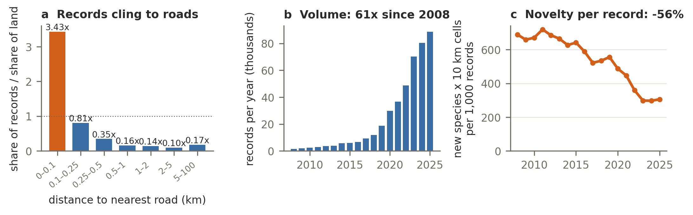
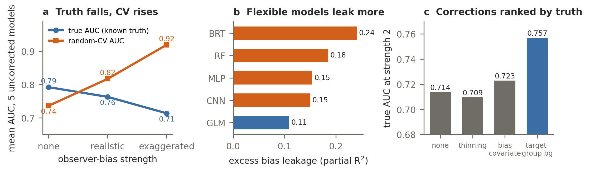
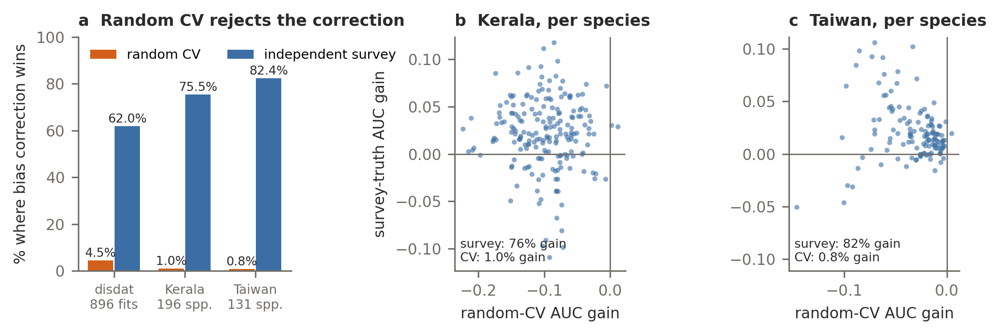
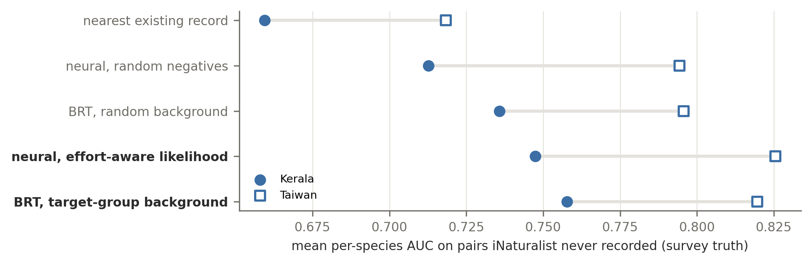
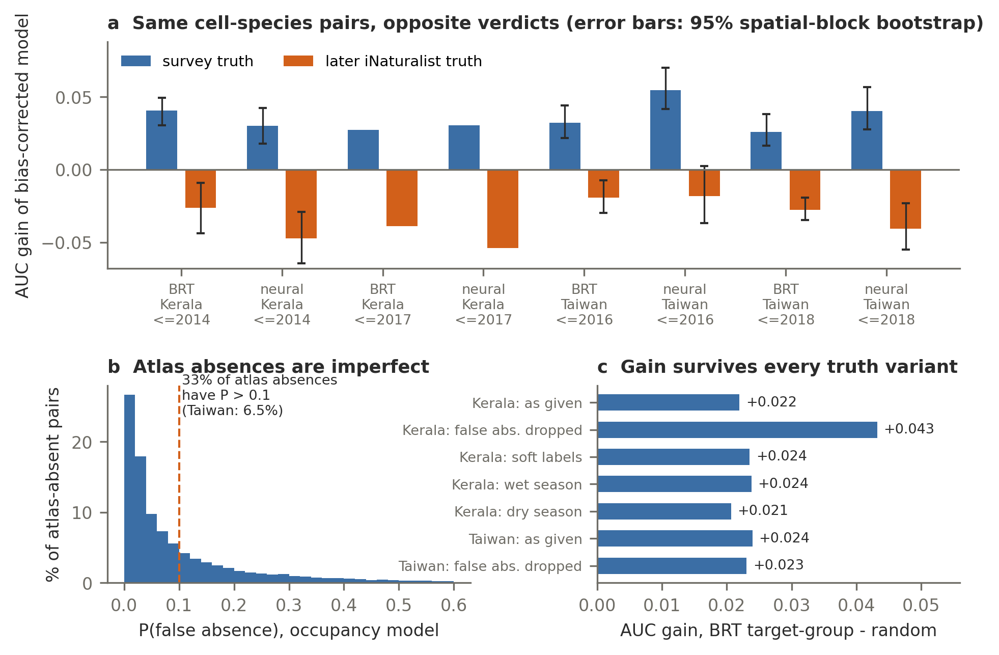
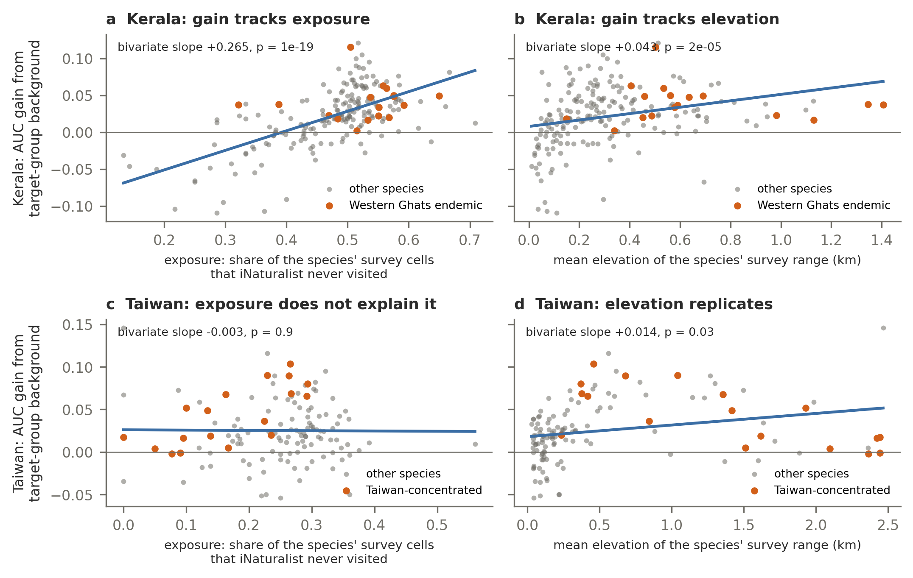
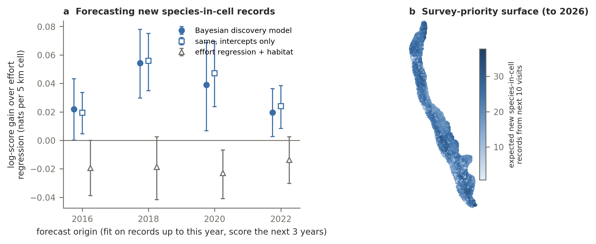

# The EVST Topic 11 project, explained from the ground up

*Ponnambalam V · Nandini C · Mohit Nallagatla · Manali Gupta · November 2026*

This document explains the project as it is presented in the final talk (`final/EVST_Topic11_Final.pptx`, 16 slides). It covers:
- what the question is;
- what data we used;
- what each model and method means, with the basic theory;
- what each experiment found;
- what is new, and what to say when asked.

It covers only the parts that worked and made it into the talk.

---

## Part 1. The project in one page

**The topic.** "Can AI identify biodiversity patterns missing from conventional sampling?" More precisely: do maps of where species *should* live, predicted from environmental data, reveal places that existing records under-represent, once we account for records being collected unevenly?

**Why it is hard.** Almost every record of where a species lives was made by a person who chose to go there. People go near roads, towns and popular parks. So the records describe two things at once: where species live, and where people look. A model trained on these records can learn the second and present it as the first. Worse, the usual way of checking the model can reward it for doing so.

**What we did.** We split the topic into testable claims (Part 3) and tested them on five datasets. Two of them are systematic bird surveys, in Kerala (India) and Taiwan, used as independent ground truth. Models were trained only on iNaturalist citizen-science records and then checked against the surveys.

**What we found.**
1. The bias is strong. In the Western Ghats, land within 100 m of a road is recorded 3.4 times more than its area predicts; land beyond 2 km, a tenth as much.
2. A corrected model finds birds that iNaturalist never recorded in a place. The model is boosted trees with *target-group background*. Among the 10% of unrecorded cell–species pairs it ranks highest, the survey finds the species:
   - 48% of the time in Kerala, against 27.5% by chance;
   - 40% of the time in Taiwan, against 17% by chance.
3. The standard checks get this backwards:
   - Random cross-validation prefers the *uncorrected* model for about 99% of species.
   - On the very same cell–species pairs, later iNaturalist records penalise the correction that the surveys reward.
4. The result is robust. Modelling missed detections in the survey makes the gains larger. Endemic and mountain species gain most.
5. A Bayesian model of *how observers sample* forecasts where new records will appear better than standard methods.

**The one-sentence answer.** Yes, AI can find biodiversity that conventional sampling misses, but only if both the model and the test used to judge it account for observer bias.

---

## Part 2. Background concepts

### 2.1 Species distribution models (SDMs)
An SDM predicts how likely a species is to be present at a place from the environment there: temperature, rainfall, elevation, forest cover. You train it on known occurrences, then predict everywhere. "AI" in our topic means flexible SDMs: boosted trees, random forests and neural networks.

### 2.2 Presence-only vs presence–absence data
- **Presence–absence data** come from a planned survey. Someone visits with a fixed method and records which species they found, so a missing species is real information.
- **Presence-only data**, like iNaturalist photos, only say where a species *was* seen, never where someone looked and did not see it. Most biodiversity data are presence-only.

A presence-only model therefore compares the places where a species was recorded (label 1) with **background** places (label 0) and learns what distinguishes them.

### 2.3 Sampling bias and how it leaks into models
If background points are spread uniformly, the recorded places differ from them in habitat *and* in accessibility (near roads). The model learns both, so its "habitat" map is partly a map of roads.

We measured this with a **bias-leakage index**: the share of variation in a model's predictions that the access layers explain beyond the true suitability. It can only be computed where the truth is known, which means virtual species.

### 2.4 Citizen science and "visits"
iNaturalist is a platform where anyone uploads photos of organisms. "Research grade" means the identification is agreed by the community. We define a **visit** as one observer on one day. This unit of effort is central to the effort-aware and Bayesian models.

### 2.5 Grids and covariates
The region is cut into 1 km cells, each carrying 34 numbers:
- **29 habitat layers:** 19 WorldClim climate variables, elevation, and the fractions of 9 ESA WorldCover land-cover classes (tree, shrub, grass, crop, built-up, bare, water, wetland, mangrove).
- **5 access layers:** distance to any road, to a major road, to a town and to a protected area, and log population density (WorldPop). These describe where *people* go.

### 2.6 AUC, the score we use everywhere
AUC answers one question: if I pick one place where the species is present and one where it is absent, how often does the model score the present place higher?
- 1.0 means perfect ranking.
- 0.5 means a coin toss.

We compute it per species and average. To compare two models we look at three things across species:
- the mean per-species difference;
- the share of species where one model wins;
- a **Wilcoxon signed-rank test**, which asks whether the differences sit consistently on one side of zero.

### 2.7 Cross-validation and why it can mislead
**Cross-validation (CV)** hides part of the data, trains on the rest, and scores on the hidden part.
- **Random CV** hides random records. Nearby records are similar, so the score is optimistic.
- **Spatial-block CV** hides whole areas, which removes much of that optimism.

Both share a deeper flaw here: the hidden records were collected by the *same biased observers*. A model that learned "near a road" scores well on held-out roadside records. That is why we need independent truth.

### 2.8 The spatial-block bootstrap
A **bootstrap** estimates uncertainty by resampling the data many times and recomputing the result. Neighbouring survey cells are alike, so we resample whole 0.3° blocks (about 33 km) rather than single cells: 59 blocks in Kerala and 49 in Taiwan, 1,000 times. This gives honest 95% confidence intervals.

---

## Part 3. The hypotheses in the talk

| | Claim | Why it matters | Verdict |
|---|---|---|---|
| H1 | Records are biased toward roads and people, measurably | You cannot correct what you have not measured | Supported |
| H2 | Flexible models absorb more of the bias than a linear model | Decides whether "AI" helps or hurts | Supported (boosted trees leak most) |
| H3 | Random cross-validation misses the damage and picks the wrong model | If the usual check fails, a good score proves nothing | Supported in 3 real systems |
| H4 | Corrections can be ranked where truth is known | We need a defensible correction | Supported: target-group background |
| H5 | Corrected models find real, unrecorded occurrences | The topic question | Yes, against both surveys |
| H6 | A Bayesian model of sampling forecasts where new records appear | A second route to "where are the gaps" | Supported, given observer-level effort |
| H7 | Later citizen-science records and a survey give opposite verdicts on the same pairs | Explains the mid-evaluation null | Supported in 2 systems |
| H8 | Endemic and mountain species gain most from correction | Who benefits | Supported in 2 systems |
| S0 | The survey truth survives a model of missed detections | Can the truth be trusted? | Supported; gains get larger |

H1 to H4 ask whether the method can be trusted. H5 is the answer. The rest explain why it works and how robust it is.

---

## Part 4. The data

### T1 Virtual species (controlled experiment)
We invented 30 species. Each prefers certain climate, elevation and natural land cover, defined by a bell-shaped (Gaussian) curve and placed on the real Western Ghats map, so we know exactly where each one lives.

We then "recorded" 300 occurrences per species, choosing places in proportion to a real observer-effort surface fitted from iNaturalist. That surface was raised to a power of 0 (no bias), 1 (realistic) or 2 (exaggerated). The design follows Inman et al. (2021).

### T2 disdat (classic benchmark)
226 real species in 6 regions: Australian Wet Tropics, New South Wales, Ontario, New Zealand, South America and Switzerland. It pairs 52,605 biased presence-only records with independent presence–absence surveys at 53,044 sites (Elith et al. 2020). It is the data behind Elith 2006 and Phillips 2009 from our literature review.

### T3 Western Ghats iNaturalist (the application)
The Western Ghats and Malabar coast: 181,347 km², 8°N to 22°N. We kept research-grade records identified to species with location error ≤ 5 km, removed records at institution or country centroids, and clipped to the region. That leaves **493,227 records of 10,219 species**, the largest groups being butterflies and moths, birds, and plants.

### T4 Kerala Bird Atlas (independent truth, India)
A systematic survey of Kerala from 2015 to 2020 on a 6.6 km grid. Trained volunteers did timed 15-minute checklists in fixed wet- and dry-season rounds, typically 32 per cell. 844 cells fall in our region.

The gap it reveals is large:
- 52% of atlas cells had no iNaturalist bird record up to 2020.
- Where iNaturalist did visit, it recorded only 12% of the species the atlas found.

### T5 Taiwan Breeding Bird Survey (independent truth, replication)
About eight count points per site, each with a six-minute count, twice per breeding season. We used 2017–2022 and the 420 sites surveyed in at least two of those years. iNaturalist Taiwan bird records were cut from the same export (67,819 usable up to 2022), and names were matched through the GBIF taxonomic backbone; 156 species were analysed.

---

## Part 5. The models and methods, with the theory

### 5.1 Measuring bias
**Intensity by distance to road.** For each distance band, divide the share of records by the share of land; 1 means fair. This fixes a flaw in the common statistic "99% of records lie within 2.5 km of a road": 95% of the Western Ghats *land* is within 2.5 km of a road.

**Sampling effectiveness** (Oliver et al. 2021). New species-by-10 km cell combinations per 1,000 records, by year. It measures how much new knowledge each record adds.

**sampbias** (Zizka et al. 2021). Records per 5 km cell are modelled as Poisson-distributed, with a rate that decays with distance to roads, towns, cities, rivers and protected areas:

$$\lambda = q \exp\left(-\sum_j w_j d_j\right)$$

- $d_j$ is the distance to feature $j$.
- $w_j$ is how fast records fall off with that distance.

A **Poisson distribution** is the standard model for counts of independent events. Our Python version matches the original R package: all six weights fall inside its 95% intervals.

### 5.2 The model ladder, simple to flexible
- **GLM:** here logistic regression. The log-odds of presence is a weighted sum of the covariates and their squares, so a species can prefer a middle value. It is simple and stable.
- **MaxEnt** (Phillips et al. 2006): the most-used presence-only SDM. It finds the most spread-out distribution that still matches the average environment at the presence points, and is closely related to a regularised logistic regression against background.
- **Random forest** (Breiman 2001): a decision tree asks a sequence of yes/no questions ("elevation > 800 m?"). A forest averages hundreds of trees grown on random subsets of the data.
- **Boosted regression trees (BRT)** (Friedman 2001; we used LightGBM): small trees grown one after another, each correcting the errors of the ones before. It is usually among the most accurate SDMs, and in our virtual-species test also the one that absorbed the most bias.
- **MLP (multilayer perceptron):** a neural network made of layers of weighted sums with simple non-linear functions between them.
- **Patch CNN** (convolutional neural network; Deneu et al. 2021): sees a 9×9 km window of all covariate layers around a point, like a small image, and learns spatial patterns with sliding filters.

### 5.3 The bias correction that works
- **Random background (the "naive" model).** 20,000 points spread uniformly over land. Roadside records are compared with random land, so "near a road" looks like habitat.
- **Target-group background (TGB)** (Phillips et al. 2009). The background is every place where *anyone recorded any species of the same group* (here, any bird). Presences and background then both come from places people visited, so the observer bias sits on both sides of the comparison and cancels. What remains is "where, among visited places, is this species found", which is much closer to habitat.

We also compared geographic thinning and bias-covariate conditioning in the virtual-species test. Both were worse than TGB.

### 5.4 The effort-aware neural network
One network predicts all species at once from the 29 habitat layers, so species share what they learn about the environment. Training minimises a **loss function**, a number measuring how wrong the predictions are. Our loss is an occupancy–detection likelihood. The chance that species $s$ is recorded in pixel $i$ is the chance it lives there, times the chance someone detected it in $U_i$ visits:

$$P(\text{recorded}) = \psi_{is}\,[1-(1-p_{is})^{U_i}]$$

- $\psi$ (psi) is **occupancy**, the probability the species is present.
- $p$ is the per-visit **detection probability**.
- $(1-p)^U$ is the chance of missing the species on every one of $U$ visits.

What this means for the data:
- A pixel visited once and not recorded is weak evidence of absence.
- A pixel visited fifty times and not recorded is strong evidence.
- An unvisited pixel is no evidence at all.

This network is the best neural model in both systems and ties boosted trees with TGB in Taiwan.

### 5.5 Occupancy model of the survey (checking the truth)
A survey "absence" may be a bird that was there but not seen. **Occupancy models** (MacKenzie et al. 2002) separate "not there" from "there but missed" using repeat visits. If a species is detected on some lists in a cell but not others, that reveals how detectable it is.

We fitted one model per species and season: occupancy depends on habitat, and detection on the number of observers and the time of day. For a pair with no detection in $K$ lists, the chance it is a false absence is

$$P(\text{false absence}) = \frac{\psi(1-p)^K}{\psi(1-p)^K + 1-\psi}$$

The top of the fraction is "present but missed $K$ times"; the bottom adds "truly absent". Before trusting the fits, we simulated surveys with known values on the real list structure and checked that the model recovers them. It did, to within 0.011 on average.

### 5.6 The Bayesian discovery model
This forecasts how many *new* species-in-cell records future visits will produce. For each 5 km cell:
- The number of species living there is **Poisson** with mean $\Lambda$.
- Each species has its own per-visit detection probability $p$, drawn from a **Beta distribution** $\text{Beta}(a,b)$, a flexible distribution for numbers between 0 and 1. A few species are easy to see; most are hard.

The probability that a species is still undetected after $U$ visits is

$$P_0(U) = \frac{B(a, b+U)}{B(a, b)}$$

where $B$ is the beta function. The expected number of new species in $m$ more visits is $\Lambda[P_0(U) - P_0(U+m)]$.

- **"Bayesian"** means each coefficient has a **prior**, a starting distribution that keeps estimates sensible when data are thin. The data turn it into a **posterior**.
- We used the most probable setting, the **MAP** estimate, and approximated uncertainty with a **Laplace approximation**, which treats the posterior as a Gaussian around its peak.
- Forecasts are judged by **log score**: the log of the probability given to what actually happened, measured in "nats". Higher is better.

The model extends Chiu's (2022) beta-binomial richness estimator to a spatial forecast.

---

## Part 6. The experiments in the talk

| ID | Question | What we did | What we found |
|---|---|---|---|
| E01 | How biased are Western Ghats records? | Road intensity, sampling effectiveness and sampbias on 493,227 records | 3.4× intensity within 100 m of roads, 0.1× beyond 2 km. Volume up 61× since 2008, new knowledge per record down 56%. Bias differs by taxon |
| E02 | Does random CV pick the right correction on real data? | disdat: 226 species, 4 algorithms, with and without TGB | Surveys favour TGB in 62% of fits, random CV in 4.5%. Spatial blocking does not fix it |
| E03 | Do flexible models absorb bias? | 30 virtual species, 3 bias levels, 5 models, 4 corrections | True AUC falls while CV AUC rises. All flexible models leak more than GLM. TGB best |
| E04 | Do corrected gaps get new records later? | 435 species, train to 2018, test on 2019–2026 | Correction moves hotspots into forest, but later records follow effort, not predictions: the mid-evaluation null |
| E05 | Can a Bayesian sampling model forecast discovery? | Beta-binomial model, 4 forecast origins | Beats the effort regression at every origin; gain comes from the sampling structure |
| E09b | Against the Kerala atlas, do models find what iNaturalist missed? | Missing-pair protocol on 170,286 pairs | Corrected BRT 0.758 AUC; +0.022 over uncorrected, +0.098 over nearest record |
| E11/E12 | Can a neural network do it too? | Effort-aware network vs random-negative network | Effort-aware beats random negatives; close to BRT-TGB |
| E15 | Does the truth source change the verdict? | Same pairs judged by the atlas and by later iNaturalist | Opposite signs at both cut-offs. Endemics gain twice as much |
| E16 | Can the atlas absences be trusted? | Occupancy model of atlas lists | A third are doubtful; correcting for them doubles the gains |
| E17 | Does it all replicate in Taiwan? | The same pipeline on the Taiwan survey | Yes: missing-pair gain, CV inversion and verdict flip all replicate. The elevation effect replicates |

---

## Part 7. The results, as a story

### 7.1 The bias is real (E01)

Records cling to roads (a). Recording volume exploded while new knowledge per record halved (b, c). More data is not the same as more coverage.

### 7.2 With known truth, CV rewards bias (E03)

As bias strengthens, uncorrected models get worse against the truth but better under cross-validation. Every flexible model leaks more bias than a GLM. Target-group background is the best correction.

### 7.3 On real data, random CV rejects the correction (E02, E09b, E17)

| | Random CV says the correction helps | Survey says it helps |
|---|---|---|
| disdat (896 fits) | 4.5% | 62.0% |
| Kerala (196 species) | 1.0% | 75.5% |
| Taiwan (131 species) | 0.8% | 82.4% |

### 7.4 Corrected models find the missing birds (E09b, E17)

The **missing-pair protocol** is our main evaluation. Take every cell–species pair iNaturalist never recorded. Ask whether the model ranks the pairs where the survey found the species above the pairs where it did not.

| | Kerala | Taiwan |
|---|---|---|
| Pairs scored | 170,286 | 58,551 |
| Survey prevalence (base rate) | 27.5% | 17.0% |
| BRT target-group AUC | 0.758 | 0.820 |
| Gain over random background (95% block CI) | +0.022 [0.015, 0.028] | +0.024 [0.015, 0.035] |
| Gain over nearest record | +0.098 | +0.101 |
| Survey hit rate in the model's top 10% | 48.4% | 40.2% |

### 7.5 Why the mid-evaluation said "not yet" (E15)

We trained on records up to a cut-off year and judged the same unrecorded pairs twice: by the survey, and by whether iNaturalist later recorded the species.
- The survey rewards the corrected model every time.
- Later iNaturalist records penalise it every time.

This holds at two cut-offs in each system and for both boosted trees and the neural network. Later records come from the same observers, so they reward the model that learned where observers go. The mid-evaluation used later records as truth, which is why it found nothing.

### 7.6 The survey truth holds up (E16, E17b)
Panels b and c of the figure above cover the robustness check.
- A typical atlas list detects a species only 8% of the time, so a third of atlas absences are doubtful.
- Dropping them doubles the gain (+0.022 to +0.043), and the model ranking never changes.
- The Taiwan survey has about 77 point counts per site, so it is much cleaner.

### 7.7 Who gains most (E15, E17)

- **Endemics:** Western Ghats endemics gain twice as much as other species, and Taiwan-concentrated species also gain more.
- **Elevation, both systems:** species of higher-elevation ranges gain more, about +0.02 to +0.03 AUC per km. Mountains are where a random-background model most often confuses "rarely visited" with "unsuitable".
- **Exposure, Kerala only:** in Kerala, the endemic gain is explained by *exposure*, the share of a species' range iNaturalist never visited. That explanation does not hold in Taiwan.

### 7.8 Modelling observers forecasts discovery (E05)

The Bayesian discovery model beats the effort regression at every forecast origin (+0.020 to +0.054 nats per cell). Classical Chao-type extrapolation fails badly. Knowing how much a cell has already been searched predicts discovery; predicted habitat adds little. The map is the deliverable: expected new records from the next ten visits.

It has two limits:
- It needs observer-level effort; without observer IDs, a "visit" is meaningless.
- It forecasts new records; it does not estimate true missing richness.

---

## Part 8. What is new, and the limits

**New, compared with the literature:**
1. **The missing-pair protocol:** scoring models only on the pairs citizen science never recorded, against an independent survey.
2. **A real-data demonstration on identical pairs**, in two systems, that later citizen-science records reverse a survey's verdict on a bias correction. Earlier work argued this mainly from simulation (El-Gabbas & Dormann 2018; Baker et al. 2024).
3. **The CV inversion with large effect sizes on real survey truth:** 1% vs 75.5% in Kerala, and 0.8% vs 82.4% in Taiwan.
4. **An occupancy audit of the truth data**, showing the gains were understated.
5. **A discovery forecast built on observer effort**, extending Chiu's (2022) beta-binomial model to space and time.

**Limits:**
- Birds only.
- The Indian truth covers Kerala only.
- No eBird data.
- The Taiwan truth unit is a 2 km neighbourhood of survey points.
- The atlas misses nocturnal and secretive species.

---

## Part 9. Questions to expect, with short answers

**"Isn't the atlas itself biased?"** It was designed not to be: every cell was surveyed with a fixed effort. Its absences are imperfect, which we modelled explicitly (E16). Correcting for missed detections made our results stronger.

**"Why not just use spatial cross-validation?"** It removes the optimism from nearby records, but the held-out records still come from the same biased observers. On disdat, blocked CV agreed with the truth only 43–44% of the time at every block size.

**"Why didn't deep learning win outright?"** The habitat layers already encode where people go: they predict population with $R^2$ = 0.88. So the decisive step is changing what records are compared against (target-group background, or our effort-aware likelihood), not adding model capacity. Boosted trees with TGB were best or tied-best in both systems.

**"What does 0.022 AUC mean in practice?"** On its own it is modest. But:
- it is the difference that random CV gets backwards;
- it is larger for endemics;
- it doubles once doubtful absences are removed.

The most practical number is the hit rate: 48% vs 27.5% in Kerala.

**"Is the Taiwan result really independent?"** Yes. It uses a different country, survey design, taxonomy and set of observers. Only the code is shared, and that code reproduced the Kerala numbers exactly before it was run on Taiwan.

**"What would you do next?"** Add eBird and a second Indian survey, test non-bird taxa, and run a field visit to the model's top-ranked unrecorded pairs.

---

## Glossary

| Term | Meaning |
|---|---|
| AUC | Probability that the model ranks a random presence above a random absence; 0.5 is chance |
| Background points | Places used as the "0" class in a presence-only model |
| Beta distribution | A flexible distribution for probabilities between 0 and 1 |
| BRT | Boosted regression trees: many small trees, each fixing the last one's errors |
| Covariate | An input variable such as temperature or tree cover |
| Cross-validation | Hold out part of the data, train on the rest, score on the held-out part |
| Detection probability ($p$) | Chance of seeing a species on one visit, given it is there |
| Endemic | A species found only in one region (Western Ghats, or Taiwan) |
| Exposure | Share of a species' survey range that iNaturalist never visited |
| GLM | Generalised linear model, here logistic regression |
| Laplace approximation | Approximate a posterior by a Gaussian around its peak |
| MAP | Maximum a posteriori: the single most probable parameter setting |
| Occupancy ($\psi$) | Probability that a species is present at a site |
| Poisson distribution | Standard distribution for counts of independent events |
| Presence-only data | Records of where a species was seen, with no record of where it was not |
| Random forest | Average of many decision trees grown on random subsets |
| Spatial-block bootstrap | Resampling whole geographic blocks to get honest confidence intervals |
| Target-group background | Background drawn from places where anyone recorded a related species |
| Visit | One observer on one day |
| Wilcoxon signed-rank test | Tests whether paired differences are consistently above or below zero |
