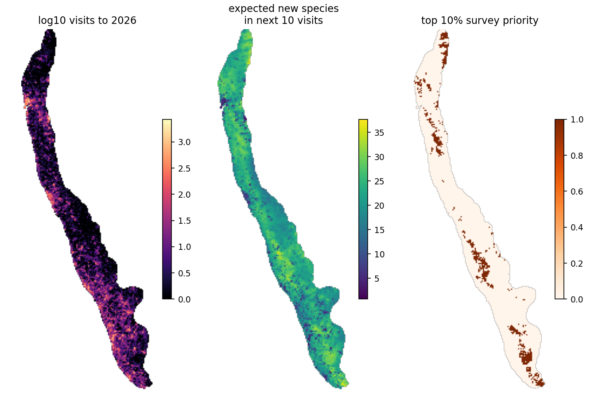
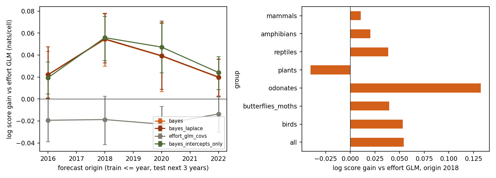

# Phase B: Bayesian models of sampling bias and discovery

EVST Topic 11 · 17 November 2026 · research report: `EVST Project/reports/Bayesian sampling bias models.md`

## What we set out to do
The mid-evaluation left one open link. Bias-corrected richness maps did **not** predict where new records
appeared in 2019–2026 once later observer effort was accounted for (β ≈ 0 ± 0.03). Phase B asked
whether a better *mathematical* model of sampling (Bayesian, effort-aware) could do what the richness
maps could not, and whether it beats the methods ecologists normally use.

Literature review (four research threads, synthesised in the report above) identified three gaps:
1. No published forward-in-time test of an "undetected species" indicator built from citizen-science
   records with effort conditioned on.
2. No published Bayesian effort model built from individual observer identity.
3. No neural or Bayesian presence-only model with an explicit bias field validated on independent
   presence/absence data that clearly beats target-group background.

## Hypotheses and pilots

| | Hypothesis | Pilot | Go criterion | Verdict |
|---|---|---|---|---|
| H6 | A hierarchical Bayesian **discovery model** forecasts new species-in-cell detections better than effort regressions and Chao-type extrapolation | E05 pilot | Log score better than baselines, bootstrap CI excluding 0 | **GO**: +0.089 nats/cell over the covariate effort regression, CI [0.069, 0.110] |
| H7 | An **observer-identity effort model** forecasts where future visits land better than access and persistence models | E06 pilot | CI excluding 0 | **Marginal**: +0.041 nats/visit, CI [0.003, 0.081]; folded in as an effort-forecast idea, not pursued further |
| H8 | A **shared Bayesian bias field** (spatial GP, all species jointly) beats target-group background on disdat | E07 pilot | ΔAUC ≥ +0.005 vs target-group background | **NO-GO**: −0.028 vs target-group background; −0.0055 when combined with it (p = 0.01). The field absorbs real habitat signal |
| H9 | Observers go where species are already known, which would explain the earlier null | E08 | Coefficient CI excluding 0 | **Rejected**: future effort is slightly *lower* in cells richer than their effort implies (rate ratio 0.94 per SD, p = 0.002) |

Only H6 passed its pilot, so only H6 got the full experiment.

## The discovery model (E05)
For each 5 km cell c:
- the species pool is Poisson with mean Λ_c;
- each species is detected on a visit (one observer-day) with probability p ~ Beta(a_c, b_c).

After U_c visits, the probability a species is still undetected is P₀(U) = B(a, b+U)/B(a, b). Poisson
thinning then gives three closed-form pieces:
- observed richness S_c ~ Poisson(Λ_c(1 − P₀(U_c)));
- each observed species' visit count ~ zero-truncated beta-binomial;
- **new species found in m further visits ~ Poisson(Λ_c[P₀(U_c) − P₀(U_c+m)])**.

log Λ, log a and log b are linear in habitat covariates (8 PCs of climate and land cover), a random-Fourier
spatial field, and access covariates for detection. All coefficients have Gaussian priors. The model is
fitted by MAP on the GPU (PyTorch, float64) with a Laplace approximation for posterior draws.

**Protocol.** Every model is fitted on records up to year T and scored on new species-in-cell detections in
T+1…T+3, given the visits that actually happened. Negative-binomial dispersion and the regression
baselines are calibrated on an earlier split (≤ T−3 → T−2…T), so nothing is tuned on the test window.

### Forecast quality (log score gain over the plain effort regression, nats per cell, all taxa)

| Forecast origin | 2016 | 2018 | 2020 | 2022 |
|---|---|---|---|---|
| Bayesian discovery model | **+0.022** [0.000, 0.043] | **+0.054** [0.030, 0.078] | **+0.039** [0.007, 0.069] | **+0.020** [0.003, 0.036] |
| Effort regression + same covariates | −0.019 | −0.019 | −0.023 | −0.014 |
| Shen–Chao extrapolation | −4.06 | −5.27 | −4.07 | −4.03 |

Intervals are 95% bootstraps over 50 km spatial blocks. The Bayesian model wins at every origin. Adding the same covariates to an ordinary regression makes it
*worse*. Classical Chao extrapolation fails badly: it cannot forecast unsampled cells and it underpredicts
how the species pool keeps expanding.

**By taxon (origin 2018):**

| Taxon group | Gain | 95% CI |
|---|---|---|
| Odonates | +0.132 | [0.062, 0.211] |
| Birds | +0.053 | [0.021, 0.081] |
| Butterflies and moths | +0.039 | [0.009, 0.071] |
| Reptiles | +0.038 | [0.008, 0.074] |
| Amphibians | +0.020 | n.s. |
| Mammals | +0.011 | n.s. |
| Plants | **−0.041** | [−0.083, 0.000] |

Plants are the exception, plausibly because plant "visits" mix very different recording behaviour.

### What drives the gain (ablation)

| Origin | 2016 | 2018 | 2020 | 2022 |
|---|---|---|---|---|
| Full model | +0.022 | +0.054 | +0.039 | +0.020 |
| No habitat covariates | +0.023 | +0.051 | +0.037 | +0.019 |
| No spatial field | +0.019 | +0.057 | +0.033 | +0.020 |
| No detection covariates | +0.014 | +0.053 | +0.051 | +0.024 |
| Intercepts only | +0.019 | +0.056 | +0.047 | +0.024 |

**The gain in forecast likelihood comes from the Bayesian detection-and-saturation structure, not from
environmental predictors.** In the pilot, adding SDM-predicted richness (naive or bias-corrected) did not
help either. This is the same message as the mid-evaluation null, now from a model that handles effort
correctly: knowing *how much has been looked* predicts discovery; predicted habitat adds little.

### Where should the next survey go? (ranking per-visit discovery rate)
This uses cells with at least 5 later visits. The target is the realised new species per visit; the
indicators are each model's predicted discoveries per visit.

| Origin | Bayesian (full) | Bayesian (intercepts) | "Fewest prior visits" | Effort regression | Shen–Chao |
|---|---|---|---|---|---|
| 2016 | **0.27** [0.19, 0.35] | 0.22 | 0.22 | 0.12 | 0.02 |
| 2018 | **0.22** [0.15, 0.28] | 0.18 | 0.10 | −0.05 | 0.11 |
| 2020 | **0.32** [0.26, 0.37] | 0.30 | 0.26 | 0.12 | 0.08 |
| 2022 | **0.36** [0.31, 0.40] | 0.32 | 0.29 | 0.30 | 0.12 |

Values are Spearman correlations with the realised rate. Cells in the Bayesian model's top 10% yielded
**1.18–1.28×** the average discovery rate (2018 CI includes 1). Shen–Chao's top 10% do about as well
(1.24–1.31×), but its overall ranking is poor. For ranking, unlike for likelihood, the habitat covariates
*do* help (full vs intercepts-only). The effort regression ranks worst.

### Calibration
The 80% predictive intervals cover 92% (Bayesian MAP), 91% (effort regression) and 90% (Laplace posterior)
of outcomes. All are conservative, because dispersion is calibrated on an earlier, noisier window. The
**Laplace posterior is unreliable for small taxon groups**: with 33 coefficients and few data its draws
inflate the forecast (birds −0.25, mammals −1.2 nats/cell relative to MAP). For small groups use the MAP
or the intercepts-only model.

### Deliverable
`data/processed/E05_expected_new_per_10_visits.tif` (bands: posterior mean, 5% and 95%) and
`results/E05_survey_priority_cells.csv`: the expected number of new species-in-cell records from the next
10 visits, for every 5 km cell, fitted on all records to 2026. The top-10% priority cells cluster in the
central Karnataka hills, the southern Kerala and Tamil Nadu ranges, and pockets of the northern Ghats.




## What this means for the topic question
**Superseded in part by `reports/phase_b_validation.md`.** Against the Kerala Bird Atlas, bias-corrected
habitat models *do* find species that iNaturalist never recorded: AUC 0.758 vs 0.659 for nearest record.
The null below came from scoring against later citizen-science records, which are biased truth. The
validation round also found that the discovery model fails in Europe without observer IDs, and that its
P₀ ranks missed species no better than visit counts.

- **Supported, with a twist.** Scored against later iNaturalist records, habitat prediction does not reveal
  where unrecorded biodiversity will turn up. A principled Bayesian model of *sampling* does, better than
  the regression and Chao methods ecologists use, at every time origin tested and for most taxa.
- **The useful indicator is a discovery forecast, not a richness map:** the posterior expected new species
  per future visit, conditioned on how much a cell has already been searched.
- **Two negative results are worth reporting.** A shared Bayesian bias field did not beat target-group
  background on independent survey truth. Observers do not chase known richness.

## Limitations
- iNaturalist only; eBird and museum records not included. Kerala Bird Atlas validation is in
  `reports/phase_b_validation.md`.
- The beta-binomial detection likelihood extends Chiu 2022/2023 (*MEE*). Present it as an extension, not
  as a new estimator.
- "New species-in-cell" counts first records, not new species to science. A detection can be new to a cell
  because of observer skill or taxonomy changes.
- Visits are defined as observer-days. iNaturalist does not record survey duration.
- The novelty claims rest on the research threads' searches (a few dozen queries). Do a targeted
  bioRxiv/EcoEvoRxiv check before claiming them in writing.

## Reproduce
```bash
python experiments/E05_discovery_pilot.py
python experiments/E05_discovery_full.py
python experiments/E05_survey_priority.py
python experiments/E06_observer_effort_pilot.py
python experiments/E07_disdat_jointbias_pilot.py --regions AWT,CAN,NSW
python experiments/E08_observers_follow_richness.py
```
The model is in `src/evst/bias/discovery.py`. Results are in `results/E05_* … E08_*`.
