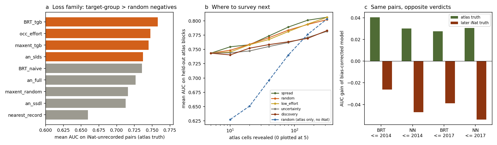

# Phase C: five hypotheses tested against atlas truth

EVST Topic 11 · 17 November 2026 · literature synthesis: `EVST Project/reports/Sampling bias novelty avenues.md`

Phase B showed that bias-corrected models find species iNaturalist never recorded, scored against the Kerala
Bird Atlas. A four-thread literature scan asked what is new there, what is already published, and which gaps
our data can close. It produced five hypotheses. All five were implemented and run on one RTX 4050.
**Every experiment is scored against the atlas, which none of the models ever saw.** Hyperparameters were
fixed in advance and never tuned on atlas truth.

The shared setup is `src/evst/data/kba.py`:
- 844 atlas cells, 207 bird species;
- iNaturalist birds up to 2020, with 26,226 records over 3,677 one-kilometre sampled pixels;
- 170,286 (cell, species) pairs that iNaturalist never recorded, of which the atlas found 27.5%.



## Summary

| | Hypothesis | Verdict | Novelty status |
|---|---|---|---|
| H10 (E15) | Later citizen-science records and a systematic survey give **opposite verdicts** on the same bias correction | **Confirmed, strongly** | Principle stated in the literature; this empirical demonstration was not found. **Publishable** |
| H11 (E15) | The extra gain for endemics comes from range–effort anti-correlation, not from endemism | **Confirmed** | Reconciles us with Ranc et al. 2017. **Publishable as a short note** |
| H12 (E13) | Choosing survey cells by model uncertainty or by expected discoveries beats random choice | **Rejected**: both are worse than random; spatially spread placement wins | First real-data test we found (prior work is simulation only). **Publishable with a second region** |
| H13 (E11, E12) | Neural multi-species losses that build target-group background or survey effort into the likelihood beat random pseudo-negatives and match BRT | **Partly**: they beat random-negative losses by 0.03 AUC but do not beat BRT with target-group background | First test of SINR/DeepMaxent-style losses against tropical survey truth. Workshop level |
| H14 (E14) | Removing accessibility from a neural SDM's internal representation (gradient reversal) improves atlas skill | **Rejected**, with a mechanism: the environmental layers themselves encode accessibility | Negative result; explains why our Bayesian bias field (H8) failed too |

## H10: the truth source decides the verdict (E15)

We trained the models on iNaturalist up to 2014 (136 species), so both test sources come later than the
training data. Every model scores the **same** (cell, species) pairs: pairs unrecorded up to 2014, in atlas
cells that iNaturalist visited again from 2015 onward. Two "truths" judge those pairs:
- the atlas;
- whether iNaturalist later recorded the species there.

| Contrast (corrected − uncorrected) | Atlas truth | Later-iNaturalist truth |
|---|---|---|
| BRT: target-group − random background | **+0.041** (77% of species better) | **−0.026** (28% better) |
| Neural: effort-aware − random negatives | **+0.030** (70%) | **−0.047** (22%) |

All four Wilcoxon tests give p < 10⁻⁴. A 2017 cut-off (197 species) gives the same pattern: atlas +0.027
and +0.031; later iNaturalist −0.039 and −0.054. Later citizen-science records follow observers, so they
**reward the model that learned where observers go**. Forward-in-time validation with citizen-science data,
which a 2025 study recommends as the fix for optimistic cross-validation, gives the wrong answer here. This
explains the mid-evaluation null and turns it into a result.

## H11: endemics gain because their ranges sit where nobody looks (E15)

The analysis is per species: 196 species, with the gain from target-group background on the never-recorded
pairs, using HC3 standard errors. *Exposure* is the fraction of a species' atlas cells that iNaturalist never
visited.

| Model | Endemic coefficient | Exposure coefficient |
|---|---|---|
| gain ~ endemic | +0.020 (p = 0.005) | – |
| gain ~ endemic + exposure | +0.005 (p = 0.52) | **+0.263 (p < 10⁻⁴)** |
| + log training cells + atlas prevalence | +0.011 (p = 0.22; permutation p = 0.15) | +0.225 (p < 10⁻⁴) |

Once exposure is in the model, the endemic effect disappears. Correction helps **any** species whose range
is under-sampled. Endemics are simply more exposed (0.53 against 0.47), and species of higher-elevation ranges
gain more (+0.031 per km, p = 0.0002). This settles the apparent conflict with Ranc et al. 2017, who found
correction can hurt narrow-ranging virtual species. What matters is not range size but how a range lines up
with sampling effort, which is what Botella et al. 2020's theory of target-group background predicts.

## H12: where should the next survey go? (E13)

The atlas serves as an oracle. We held out 30% of 0.3° blocks for testing and revealed pool cells in batches
of up to 320. After each batch, the effort-aware neural model was refitted on iNaturalist plus the revealed
atlas cells. We ran 5 random splits.

| Atlas cells revealed | 10 | 40 | 160 | 320 |
|---|---|---|---|---|
| Atlas only, random placement (no iNaturalist) | 0.627 | 0.696 | 0.776 | 0.803 |
| iNaturalist + atlas, random placement | 0.749 | 0.771 | 0.794 | 0.802 |
| + spatially spread placement | **0.755** | **0.774** | **0.801** | **0.807** |
| + fewest-iNaturalist-visits placement | 0.746 | 0.767 | 0.795 | 0.806 |
| + highest model uncertainty | 0.744 | 0.755 | 0.771 | 0.782 |
| + most expected undetected species | 0.740 | 0.759 | 0.769 | 0.783 |

iNaturalist alone scores 0.744.
- **iNaturalist is worth about 80 atlas cells**, roughly 640 hours of standardised survey. A model trained only
  on atlas cells needs about 80 of them to match iNaturalist alone, and about 300 before iNaturalist stops adding
  anything.
- **Model-guided placement is worse than random**: −0.023 at 160 cells, in 0 of 5 splits better. Spatially
  spread placement beats random in **5 of 5** splits (+0.0075 at 160). Uncertainty sampling chases cells
  where the biased model is unsure. Those are disproportionately well-visited cells: only 27–45% of the
  cells it picks were never visited by iNaturalist. It therefore puts survey effort back into the bias.
  Henrys et al. 2024 warned that model-based allocation could make bias worse, and so far that warning had
  only been tested in simulation.
- This is a single model class with greedy batch selection. A second region is needed before the finding is
  general.

## H13: which neural loss finds the missing species? (E11, E12)

We trained one 3-layer MLP for all 207 species, as a 5-seed ensemble, under six losses. The scores are mean
per-species AUC on the 196 species with enough never-recorded pairs.

| Loss | Negatives come from | AUC |
|---|---|---|
| `an_ssdl` (SINR, random locations) | random land | 0.713 |
| `maxent_random` (DeepMaxent, random background) | random land | 0.716 |
| `an_full` (SINR default: both) | random + other species | 0.727 |
| `an_slds` (SINR, same-location other species) | sampled pixels | 0.737 |
| `maxent_tgb` (DeepMaxent, target-group background in the loss) | sampled pixels | 0.745 |
| **`occ_effort`** (new: occupancy × detection, 1 − (1−p)^visits) | sampled pixels, weighted by effort | **0.748** |
| BRT with target-group background (Phase B) | sampled pixels | **0.758** |

- Losses that take negatives from where people actually looked beat losses with random-location negatives
  by **+0.021 to +0.035** (69–78% of species, p < 10⁻⁴). SINR's default `an_full` mixes the two and does
  worse than `an_slds` alone, because the random negatives bring the bias back.
- **DeepMaxent's published advantage over BRT with target-group background does not replicate** on tropical
  atlas truth: −0.013 (p < 10⁻⁴). BRT with target-group background stays best overall. The neural models win
  only for endemics: `occ_effort` scores 0.858 against BRT's 0.834.
- The effort-aware likelihood beats plain target-group BCE in every effort stratum. Its largest gain
  (+0.015, 72% of species, p < 10⁻⁴) is in cells with 1–5 iNaturalist visits, where treating "not recorded"
  as "absent" is most wrong.
- **The detection sub-model ranks well but is not calibrated in absolute terms.** It orders cells by the
  fraction of species iNaturalist recorded with Spearman 0.81. But it predicts 10% recorded after one visit
  where 1.7% is observed, because detection was learned per pixel while atlas presence is per cell. The
  Bayesian discovery model errs the other way (0.3%). Neither gives a trustworthy absolute "fraction missed".

## H14: can a network be trained to forget accessibility? (E14)

A gradient-reversal adversary tried to predict road distance, town distance, reserve distance, population and
iNaturalist effort from the network's hidden layer, while the main network was trained to defeat it.

- **Every adversary strength reduced atlas skill.** For the effort-aware loss, AUC fell by 0.10–0.24. For
  the random-negative loss it fell by 0.05–0.06 at λ ≥ 0.3. Training also became unstable: two runs
  produced degenerate embeddings.
- **Why it fails.** The 29 environmental inputs already predict accessibility almost perfectly. A boosted
  model on the raw inputs reaches R² = 0.58–0.68 for road and town distance, 0.84 for reserve distance and
  0.88 for population. A trained network's hidden layer encodes accessibility no more than an *untrained*
  network's does (R² 0.37–0.76 for both). So the network does not amplify bias. Accessibility is
  inseparable from habitat in the covariates. Removing it from the representation removes habitat too, the
  same failure as the shared Bayesian bias field (H8).
- Target-group background works because it corrects *which background points the model compares against*,
  not the features. This is the mechanism-level argument for the method we recommend.

## What is publishable (candid)

1. **Evaluation paper (strongest)**: "Citizen-science validation rewards observer bias". It combines four
   results:
   - the missing-pair protocol (Phase B);
   - random cross-validation inverting the model choice (1% vs 75.5% of species);
   - E15's opposite verdicts on identical pairs;
   - the exposure mechanism.
   It is real data on two systems, positioned as the empirical answer to the simulation studies of Baker et
   al. 2024. Suitable journals: Ecography, Methods in Ecology and Evolution, Diversity and Distributions.
   Before submitting, it still needs:
   - a co-occurrence or matrix-completion baseline;
   - a sensitivity check on atlas non-detections;
   - spatial-block CIs on the per-species contrasts;
   - a targeted check of EcoEvoRxiv preprint 9244.
2. **Survey-allocation note (promising)**: "model-guided" survey placement underperformed random and spatial
   coverage on real atlas truth. It needs a second region, for example the Mysuru atlas or BTO 10 km data, and
   a second model class.
3. **Workshop paper**: modern neural losses (SINR, DeepMaxent) against tropical survey truth, plus the
   finding that the leakage is already in the covariates.
4. **Not novel on its own**: the effort-aware likelihood (an occupancy-style detection term), the
   gradient-reversal arm, and the detection calibration.

## Not done, and why
- **Do satellite and location foundation embeddings leak bias?** Testing SatCLIP, GeoCLIP or AlphaEarth
  needs either the SatCLIP repository and GeoCLIP package, whose install was not permitted in this session,
  or an Earth Engine export. E14's control already suggests the answer depends on whether the embedding is
  more than a function of environment.
- **A second Indian truth region** needs eBird EBD access (about a week's approval) or the Mysuru atlas from
  Dryad.

## Reproduce
```bash
python experiments/E11_neural_losses_kba.py --seeds 5
python experiments/E12_effort_detection_kba.py
python experiments/E13_atlas_oracle_allocation.py --splits 5
python experiments/E14_adversarial_debias_kba.py
python experiments/E14b_leakage_controls.py
python experiments/E15_truth_source_and_endemics.py --train-end 2014
python experiments/E15_truth_source_and_endemics.py --train-end 2017
python experiments/E11_E15_figure.py
```
Results are in `results/E11_* … E15_*`. The multi-species models are in `src/evst/models/multisdm.py`.
