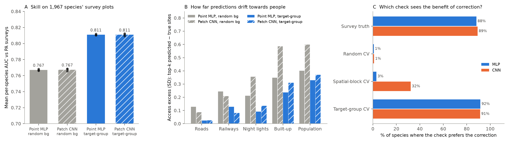

# Phase D: the CNN on real survey truth (GeoLifeCLEF 2024, Europe)

EVST Topic 11 · 18 November 2026 · follows `reports/phase_d_robustness.md`

At the mid-evaluation the patch CNN had the lowest true AUC of any model (E03). We called that test unfair to the
CNN. E03's virtual species responded only to point values, so spatial context could not help. The deck promised a
fair test: "GeoLifeCLEF 2024: the CNN on real European survey plots". This report delivers it.

**Questions.**
1. Does spatial context (a patch CNN) beat a point model on independent survey truth?
2. Does it absorb more observer bias (H2), and does target-group background still fix that?
3. Do the internal checks pick the right model (H3), on a third independent system?

## Data and design (E19)

| | |
|---|---|
| Training data | GLC24 presence-only plant records: 5.08 M records over 822,558 occupied 1 km cells, largest sources: Pl@ntNet 45%, Danish EPA 14%, iNaturalist 12%, Norwegian NBIC 12%. No observer IDs. |
| Truth | GLC24 presence/absence surveys: 88,987 standardised plots, **never used in training** |
| Species | 1,967 species with ≥ 20 survey presences and ≥ 20 PO records. Median survey prevalence 0.13% |
| Environment (model inputs) | 30 layers on a 1 km EPSG:3035 grid (3,971 × 3,820): 14 CHELSA bioclim variables, 3 SoilGrids layers, 13 MODIS land-cover fractions |
| Access (never inputs) | Human Footprint 2009 pressure layers: roads, railways, night lights, built-up, population density. Used only to measure leakage |

**Models.** Both are one multi-species network with a shared trunk and 1,967 outputs.
- **Point MLP:** the 30 values of the centre 1 km pixel, fed through 3 × 512 hidden units.
- **Patch CNN:** a 15 × 15 km window of the same layers through 4 conv layers, concatenated with the centre pixel, then 2 × 512 units. Training uses rotation and flip augmentation.

Each architecture is trained with two kinds of background:
- **random:** presences against random land cells (uncorrected);
- **target-group:** presences against other species' PO cells (Phillips 2009).

Every run takes 30,000 steps. Hyperparameters were fixed in advance and never tuned on survey truth. Each of the
4 combinations ran with 3 seeds on a random 80/20 split of PO cells, and with 1 seed on a 50 km spatial-block
split. Training ran on Ada (GTX 1080 Ti): about 5 minutes per MLP run and 18–34 minutes per CNN run.

**Measures**, per species:
- **Survey AUC:** truth.
- **Random CV AUC:** held-out PO cells vs random land cells, the usual check.
- **Target-group CV AUC:** held-out PO cells with vs without the species.
- **Access excess:** the mean access z-score of the model's k highest-ranked survey plots, minus that of the k plots
  where the species was actually found. k is the number of true presences. Positive values mean the model puts the
  species closer to people than it really is.

A per-species LightGBM BRT (project settings, 300 random species) serves as the classical reference (E19b).



## 1. Spatial context does not improve survey skill

Mean per-species survey AUC (1,967 species, mean ± SD over 3 seeds):

| | Random background | Target-group background |
|---|---|---|
| Point MLP | 0.767 ± 0.001 | **0.811 ± 0.001** |
| Patch CNN | 0.767 ± 0.002 | **0.811 ± 0.002** |
| BRT, same 300 species (MLP / CNN on that subset) | 0.765 (0.760 / 0.758) | 0.800 (0.803 / 0.803) |

- **CNN − MLP is +0.0003 with random background and −0.0000 with target-group background.** The per-seed
  differences are +0.002, +0.001 and −0.003, and they flip sign. On the spatial-block split the CNN is 0.010 *worse*
  with random background and 0.002 better with target-group background.
- With rich 1 km covariates, a 15 km neighbourhood adds no skill on real survey plots. So the mid-evaluation CNN
  result was not only an artefact of point-value virtual species: spatial context does not help here either.
- Both networks roughly match BRT (+0.003 with target-group background), so architecture is not the lever.

## 2. The CNN absorbs more observer bias (H2, now on real data)

Access excess in SD units, mean over species and seeds:

| | Roads | Railways | Night lights | Built-up | Population | **Index** |
|---|---|---|---|---|---|---|
| MLP, random background | 0.13 | 0.24 | 0.21 | 0.35 | 0.40 | **0.28** |
| CNN, random background | 0.09 | 0.21 | 0.36 | 0.59 | 0.60 | **0.40** |
| MLP, target-group | 0.02 | 0.13 | 0.09 | 0.24 | 0.33 | **0.17** |
| CNN, target-group | 0.03 | 0.08 | 0.14 | 0.31 | 0.37 | **0.20** |
| BRT random / target-group (300 species) | 0.17 / 0.00 | 0.17 / 0.07 | 0.27 / 0.03 | 0.51 / 0.16 | 0.52 / 0.25 | 0.35 / 0.11 |

- **Every model puts species closer to people than they really are.** All entries are positive.
- **With random background, the CNN drifts 40% further than the MLP** (+0.11 SD; 66% of species; all 3 seeds;
  Wilcoxon p ≈ 0).
- **The extra drift comes from settlement, not roads.** The CNN adds +0.20 SD on population, +0.24 on built-up
  and +0.15 on night lights, but slightly *less* on roads (−0.04). A 15 km window lets the network recognise towns
  and suburbs, which is where app and portal users record plants. It learns "near a town" as habitat. That is H2's original
  claim, that deeper models absorb more bias, which E03's virtual species could not show.
- **Target-group background removes most of it, and removes more from the CNN.** Access excess drops by 0.20 SD for
  the CNN and 0.11 for the MLP. Afterwards the gap shrinks to +0.03.
- Survey AUC is identical across architectures while access excess differs. So the CNN's extra settlement signal
  is not habitat the surveys reward. It is observer behaviour.

## 3. Internal checks pick the wrong model, on a third system (H3)

**Does bias correction help?** Share of species where each check prefers target-group background:

| Check | MLP | CNN | Agreement with truth (MLP / CNN) | Spearman of Δ with truth (MLP / CNN) |
|---|---|---|---|---|
| **Survey truth** | **88%** | **89%** | – | – |
| Random CV | **0.7%** | **0.9%** | 12% / 11% | −0.24 / −0.20 |
| Spatial-block CV (50 km) | 3% | 32% | 12% / 35% | −0.19 / +0.02 |
| Target-group CV | 92% | 91% | **86% / 86%** | +0.35 / +0.36 |

Bias correction gains +0.044 AUC (88% of species, p ≈ 0). Random CV says the opposite for 99% of species, and
spatial blocking barely changes that. Only scoring against held-out *target-group* sites tracks the truth. That
check uses no survey data at all.

**Is the CNN better than the MLP?** Truth says yes for 55% of species, essentially a coin flip. Random CV says yes
for 93% (Spearman with truth 0.01). Spatial-block CV says yes for only 5%. Neither check carries information
about the architecture choice.

**The H3 reversal now holds on three independent real-data systems:**

| System | Truth | Random CV agrees with truth on the correction |
|---|---|---|
| disdat (6 regions, mid-evaluation) | 53,044 survey sites | 38% |
| Kerala Bird Atlas (phase B) | systematic atlas | 25.5% |
| **GLC24 Europe (this report)** | **88,987 survey plots** | **12%** |

## What this changes

| Claim | Before | After E19 |
|---|---|---|
| H2: flexible models absorb more bias | Partly: trees worst, not the CNN (virtual species) | **Supported on real data for the CNN**: +40% access excess, via settlement context |
| The mid-evaluation CNN result was unfair | Open | **Settled**: on real surveys spatial context adds no skill (Δ AUC ≈ 0 over 3 seeds) |
| H3: standard checks pick the wrong model | 2 systems | **3 systems, 1,967 more species**: random CV prefers the uncorrected model for 99% of species |
| H4: target-group background is the correction to use | disdat + virtual + Kerala | **+0.044 AUC on 88% of species** and the largest cut in leakage, for every architecture |
| "AI" vs classical | – | MLP, CNN and BRT are within 0.003 AUC. The correction matters about 15× more than the architecture |

**One-line answer for the topic question:** a more powerful AI does not see past the observers. Given spatial
context, it learns them more precisely. Only the bias correction, plus an evaluation that does not reuse biased
records, recovers the real pattern.

## Limitations
- One CNN design (15 km window, 4 conv layers) on 1 km covariates. GLC24 also ships 10 m Sentinel-2 patches, so a CNN
  on finer imagery is untested. The PO patches are 34 GB, which was not practical over Ada's throttled link.
- Access is measured with 2009 Human Footprint layers. The survey plots are 2017–2021. The excess measure compares
  models against each other, so a stale baseline affects all models equally.
- GLC24 PO records have no observer IDs, so effort-aware losses (E11/E12's `occ_effort`) could not be tested here.
- The spatial-block split has one seed per model, and the Europe-wide survey plots are themselves spatially
  clustered by country.

## Reproduce (on Ada)
```bash
python scripts/glc24_seafile_download.py ~/evst_data/raw/glc24 --workers 32   # ~1.2 GB, about 50 min on Ada
sbatch scripts/ada_env.sh
sbatch scripts/ada_e19.sh 30000     # smoke test, prep, BRT reference, 16 GPU runs, analysis (~4.5 h)
python experiments/E19_figure.py
```
Per-run outputs are in `results/E19/E19_{model}_{background}_{split}_s{seed}.csv`. The summaries are
`results/E19/summary_*.csv`, and the BRT reference is `results/E19/E19b_brt.csv`.
