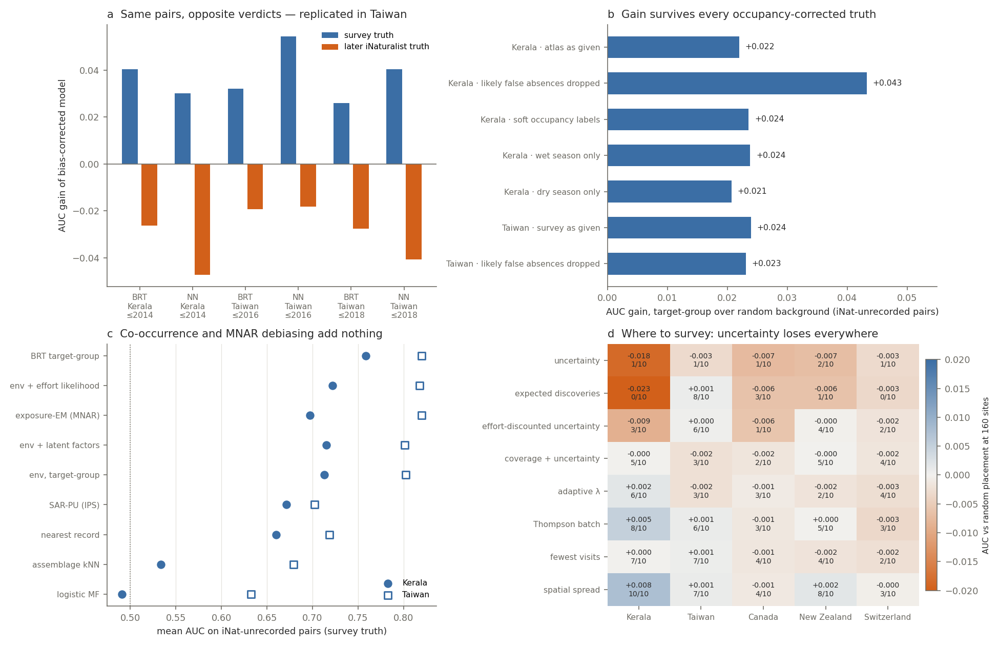

# Phase D: three orthogonal branches

EVST Topic 11 · 17–18 November 2026 · branch `phase-d`

Phases B and C rested on a single truth source, the Kerala Bird Atlas. All their methods came from one family: SDMs with corrected background or effort. Phase D adds three things:
1. **A second independent truth system.** The Taiwan Breeding Bird Survey with Taiwan iNaturalist data.
2. **An orthogonal method family.** Missing-not-at-random (MNAR) matrix completion borrowed from recommender systems.
3. **Adaptive survey allocation tested in five systems on three continents.**

Before any of that, S0 checks whether the atlas's own absences can be trusted.



## Data changes

**The US BBS was replaced by the Taiwan Breeding Bird Survey.** The US Breeding Bird Survey download sits behind a Cloudflare bot check, which we did not try to get around. Its replacement is the Taiwan Breeding Bird Survey, retrieved through the TaiBIF IPT as a GBIF sampling-event dataset under CC BY-NC.
- It has 633 sites, each with 100 m point counts.
- Each site has about 8 points and 2 visits per breeding season, from 2009 to 2022.

**Taiwan system set-up** (`src/evst/data/taiwan.py`):
- **Truth:** a species counts as present at a site if it was detected there in 2017–2022.
- **Truth unit:** the 1 km pixels within 2 km of a site's survey points.
- **Sites kept:** 420 sites surveyed in at least 2 of those years.

**Training data and covariates:**
- **iNaturalist:** 218,610 research-grade bird records, cut from our local iNaturalist dump.
- **Covariates:** the same 29 environmental layers (WorldClim, WorldCover) and 5 access layers (OSM) as Kerala. The one exception: `pop_log` is a proxy built from smoothed built-up fraction, because WorldPop has no Taiwan layer.

**Species names.** Survey and iNaturalist names were both mapped to the GBIF backbone. 278 of the 346 survey species match iNaturalist; the 156 with at least 20 training cells are analysed.

**"Taiwan-concentrated" species.** These are species with at least 90% of their global iNaturalist records inside Taiwan. 31 species qualify, close to Taiwan's endemic bird list, and 17 of them are among the analysed species.

**disdat** (already on disk) supplies three regions with large presence–absence pools for the allocation branch: Canada, New Zealand and Switzerland.

## Scorecard against the pre-registered predictions

The predictions were written into this file before any Taiwan, matrix-completion or allocation result was seen.

| | Prediction | Outcome |
|---|---|---|
| P1 | Taiwan: target-group BRT beats random-background BRT and nearest-record on unrecorded pairs | **Confirmed**: +0.024 (81% of species) and +0.101 (95%), p < 10⁻⁴ |
| P2 | Random CV prefers target-group for under 25% of species; truth prefers it for over 50% | **Confirmed**: 0.8% vs 82.4% (Kerala: 1% vs 75.5%) |
| P3 | Same-pair verdict flip at both the 2016 and 2018 cut-offs | **Confirmed** at both cut-offs, for BRT and the neural model |
| P4 | Exposure absorbs the Taiwan-concentrated effect | **Rejected**: the endemic effect *grows* once exposure is added (+0.033, permutation p = 0.0005) |
| P5 | Occupancy-corrected truth keeps every sign | **Confirmed** in both systems |
| P6 | Pure co-occurrence models lose to BRT and give no lift in unvisited cells | **Confirmed**: MF 0.49 and kNN 0.53 in Kerala |
| P7 | Latent factors add at most +0.005 | **Confirmed**: +0.002 in Kerala, −0.001 in Taiwan |
| P8 | Exposure-EM ≥ the unit-level effort likelihood, but < BRT | **Split**: worse in Kerala (−0.025, p = 0.001); tied in Taiwan (+0.002, p = 0.055) |
| P9 | Coverage + uncertainty ≥ spatial spread in at least 2 of 3 systems | **Rejected**: it matches random, not spread |
| P10 | Uncertainty-only < random in at least 2 of 3 systems | **Confirmed in 5 of 5 systems** |
| P11 | Kerala: effort-discounted uncertainty beats plain uncertainty | **Confirmed**: −0.009 vs −0.018 relative to random, at 160 cells |

## S0. Is the atlas's absence data trustworthy? (E16, E17b)

**Method.** We fitted a single-season occupancy model for each species and season (`src/evst/truth/occupancy.py`). Replicates are the atlas's lists, about 14 per cell per season. Detection depends on observer count and time of day. Fitting is batched maximum likelihood on the GPU.

**Recovery gate.** On simulated data built on the real list structure, ψ is recovered with a median error of 0.011 (90th percentile 0.033). Predicted false-absence rates are calibrated: 0.071 predicted against 0.073 true.

**The atlas is a noisier truth than we had assumed:**
- Median per-list detection is 0.08.
- Across the atlas-absent pairs, the mean P(false absence) is 0.12.
- 33% of those pairs have P(false absence) > 0.1.

**The Taiwan survey is much cleaner:**
- Each site has about 77 point counts, against about 14 lists per season in a Kerala cell.
- Mean P(false absence) is 0.023, and only 6.5% of absent pairs exceed 0.1.

**Every headline result survives, and the atlas ones get stronger:**

| Contrast (iNat-unrecorded pairs) | Atlas | Likely false absences dropped | Soft labels | Wet only | Dry only |
|---|---|---|---|---|---|
| BRT target-group − random | +0.022 | **+0.043** | +0.024 | +0.024 | +0.021 |
| Neural effort-aware − random negatives | +0.035 | **+0.071** | +0.042 | +0.033 | +0.035 |
| E15 same-pair gain (BRT, ≤2014) | +0.040 | **+0.060** | +0.037 | – | – |

- **Model ranking is identical** under all five truth variants (Kendall τ = 1.0), including wet-season against dry-season truth.
- **Taiwan:** +0.024, and +0.023 with likely false absences dropped.
- **Why the corrected numbers rise.** The atlas's missed presences sit where species are likely to occur, so they penalise good models. Treating the atlas as perfect truth therefore *understated* our gains.

**A side finding.** Across species, the per-visit "detection" the effort-aware neural network learned from iNaturalist is **negatively** correlated with the atlas's real per-list detection (Spearman −0.54).
- Species that atlas surveyors detect easily, the common and vocal ones, get *low* iNaturalist "detection".
- So that parameter measures what iNaturalist users choose to photograph, not how detectable a bird is.
- This explains E12's calibration failure. It also warns against reading detection parameters fitted to citizen-science data as detectability.
- So far it is shown in Kerala only.

## Branch 1. Taiwan replicates the evaluation results (E17, E15)

| | Kerala (Phases B–C) | Taiwan (Phase D) |
|---|---|---|
| Pairs iNaturalist never recorded; share the survey found | 170,286; 27.5% | 58,551; 17.0% |
| BRT target-group, AUC on those pairs | 0.758 | 0.820 |
| − random background | +0.022 (76% of species) | +0.024 (81%) |
| − nearest record | +0.098 | +0.101 |
| Neural effort-aware − BRT target-group | −0.011 | **+0.006** (65%, p = 0.0006) |
| BRT target-group hit rate in the top 10% (base rate) | 48.4% (27.5%) | 40.2% (17.0%) |
| Random CV prefers target-group / survey truth does | 1% / 75.5% | **0.8% / 82.4%** |
| CV optimism: random background / target-group | +0.109 / −0.011 | +0.073 / +0.019 |

**The verdict flip replicates** at both cut-offs. On the same pairs, the gain of the corrected model is:

| Cut-off | Contrast | Survey truth | Later iNaturalist truth |
|---|---|---|---|
| ≤2016, 112 species | BRT | +0.032 (83%) | **−0.019** (30%) |
| ≤2016 | Neural | +0.055 (87%) | **−0.018** (40%) |
| ≤2018, 142 species | BRT | +0.026 | **−0.028** |
| ≤2018 | Neural | +0.040 | **−0.041** |

All tests give p < 0.003. That makes three cut-offs, two systems and two model families, and every time later citizen-science records reward the model that learned where observers go.

**The exposure mechanism from Phase C does not travel:**
- In Taiwan, concentrated species gain more (+0.033 once covariates are in, p = 0.0002; permutation p = 0.0005).
- Yet they are *less* exposed to unvisited cells than other species (0.34 vs 0.47).
- So "range sits where nobody looks" explains the Kerala endemic gain but not Taiwan's.
- **What does replicate is elevation.** Species of higher-elevation ranges gain more: +0.031 per km in Kerala, and +0.031 (≤2016) and +0.022 (≤2018) per km in Taiwan.
- A shared reading is that montane assemblages are where random-background models confuse "rarely visited" with "unsuitable".

## Branch 2. MNAR matrix completion (E18)

**Set-up** (`src/evst/models/mnar.py`):
- The region is tiled into 1/16° units: 4,595 in Kerala, whose first 844 are the atlas cells. All models are scored on the atlas units' unrecorded pairs.
- **The novelty audit** found no exposure-based or inverse-propensity factorisation fitted to presence-only data and checked against independent truth. The audit is in `EVST Project/research_notes/Phase D novelty audit/`. The closest risk, Brun et al. 2026, still needs a full-text read.

**Synthetic gate (Kerala's real effort, environment and access, 100 virtual species).**
- Exposure-EM is best at recovering hidden presences: 0.657, against 0.627 for the effort likelihood and 0.538 for MF.
- It recovers the direction of the true access effect (cosine 0.82).
- SAR-PU fails even here (0.519): inverse-propensity weights of up to 20 make it unstable.

**Real data, mean AUC on unrecorded pairs:**

| Model | Kerala | Taiwan |
|---|---|---|
| Logistic MF (co-occurrence only) | 0.491 | 0.633 |
| Assemblage kNN | 0.533 | 0.679 |
| SAR-PU (inverse propensity) | 0.671 | 0.702 |
| Environment, target-group | 0.713 | 0.802 |
| + latent factors (latent-factor joint SDM) | 0.715 | 0.801 |
| Environment + effort likelihood (unit level) | 0.722 | 0.818 |
| Exposure-EM (MNAR) | 0.697 | 0.820 |
| BRT target-group (pixel level, reference) | **0.758** | 0.820 |

**What it shows:**
- **Co-occurrence is nearly useless for citizen-science gaps.** Where iNaturalist recorded nothing, a cell's assemblage is empty and kNN/MF fall to 0.5. Even in visited cells they reach only 0.56 (Kerala) and 0.68 (Taiwan). A cell's partial species list carries little information about which species it is missing. This is the co-occurrence baseline the evaluation paper needed, and the answer is clear.
- **Exposure modelling hits the same wall as E14.** The learned access coefficients say detection *rises* with distance from roads: +1.76 in Kerala, +3.29 in Taiwan. That is backwards for a sampling process. Because the covariates encode access and habitat together, the exposure term absorbs habitat signal.
  - In Kerala that costs 0.025 AUC; in Taiwan it breaks even.
  - The identifiability that works in simulation does not survive real data.
- **Neither latent factors nor exposure beat BRT with target-group background** in either system.
- **Aggregating to units costs skill.** The pixel-level effort-aware network beats its unit-level twin by 0.026 in Kerala and 0.008 in Taiwan.

**Deviation from plan.** Doubly robust MF was dropped. It needs entries whose true label is observed, and presence-only data has none, so it collapses to SAR-PU.

## Branch 3. Where should the next survey go? (E19, E19b)

**Set-up:**
- **Kerala and Taiwan:** reuse the E13 harness (`src/evst/allocate/acquire.py`) with 10 block splits. Each strategy refits the effort-aware network on PO plus the revealed survey cells.
- **Reproduction check:** the random strategy reproduces E13 exactly (largest difference 0.0).
- **disdat:** a multi-species MLP at site level, a 2,000-site pool and a 3,000-site spatially blocked test set. Effort is proxied by the count of PO records within 0.5% of the region's extent, which leaves about 30% of sites unvisited.

**AUC relative to random placement at 160 sites, with splits better out of 10:**

| Strategy | Kerala | Taiwan | Canada | New Zealand | Switzerland |
|---|---|---|---|---|---|
| Uncertainty | **−0.018** (1) | −0.003 (1) | −0.007 (1) | −0.007 (2) | −0.003 (1) |
| Expected discoveries | −0.023 (0) | +0.001 (8) | −0.006 (3) | −0.006 (1) | −0.003 (0) |
| Effort-discounted uncertainty | −0.009 (3) | 0.000 (6) | −0.006 (1) | 0.000 (4) | −0.002 (2) |
| Coverage + uncertainty | 0.000 (5) | −0.002 (3) | −0.002 (2) | 0.000 (5) | −0.002 (4) |
| Adaptive λ | +0.002 (6) | −0.002 (3) | −0.001 (3) | −0.002 (2) | −0.003 (4) |
| Thompson batch | +0.005 (8) | +0.001 (6) | −0.001 (3) | 0.000 (5) | −0.003 (3) |
| Spatial spread | **+0.008 (10)** | +0.001 (7) | −0.001 (4) | +0.002 (8) | 0.000 (3) |

**What it shows:**
- **Uncertainty sampling is worse than random in all five systems.** It beats random in only 1–2 of 10 splits each time. E13's single-region result is now a robust finding across three continents, two model classes and both PO+PA and site-level designs.
- **Bias-aware acquisition repairs the damage but does not add value.**
  - Effort discounting halves uncertainty's loss.
  - Coverage + uncertainty and adaptive λ bring it back to random.
  - In Kerala these strategies placed *every* survey in unvisited cells, yet still did no better than random.
  - So steering effort away from observers is necessary but not sufficient.
- **Spatial spread is the only strategy that wins clearly**, and only in Kerala (10/10 splits) and New Zealand (8/10). Elsewhere it ties random.
- **Learning the map and finding new species conflict.** In Kerala, "expected discoveries" yields the most new presences per surveyed cell (64.4 against 56.2 for random) and the worst map. Survey design has to choose its objective.
- **The "oracle" is not a ceiling.** Greedily picking the cells with the largest current error refits poorly, and in Kerala it does worse than spread. We report it only as a diagnostic.

## What is publishable (candid)

1. **Evaluation paper, now much stronger.** Working title: "Citizen-science validation rewards observer bias: evidence from two tropical/subtropical bird surveys".
   - What is now in hand:
     - the missing-pair protocol;
     - the CV inversion, replicated (1%/75.5% and 0.8%/82.4%);
     - the same-pair verdict flip at three cut-offs in two systems;
     - robustness to occupancy-corrected truth, which strengthens the gains;
     - the elevation-dependent gain, replicated.
   - **The Kerala exposure mechanism must be presented as system-specific.**
   - Remaining before submission: block-bootstrap CIs on the Taiwan contrasts, a full read of Brun et al. 2026, and EcoEvoRxiv 9244.
   - Target: Methods in Ecology and Evolution or Ecography.
2. **Allocation note.** "Uncertainty sampling misallocates biodiversity surveys: a five-system test against real survey truth."
   - A robust negative result plus the finding that bias-aware fixes only restore random.
   - The audit found only simulation or expert-map tests before this.
   - Suitable as a short methods note.
3. **MNAR completion, a negative result with a mechanism.** Co-occurrence carries almost no signal for citizen-science gaps, and exposure models cannot separate access from habitat on real covariates. Workshop level, or a section of paper 1.
4. **Side finding.** Citizen-science "detection" anti-correlates with real detectability. Interesting, but shown in one system only.

## Deviations and limitations

- **Taiwan replaced the US BBS**, which was behind a bot check. The Taiwan truth unit is a 2 km neighbourhood of survey points, not a grid cell, and its access layer uses a built-up proxy for population.
- **disdat has no observer data.** Effort there is a proxy (PO-record density), so the "effort" strategies are weaker tests there.
- **Allocation uses one model class per testbed** with greedy batch selection.
- **E09b and E11 were not given a `--system` flag.** E17 reproduces their Taiwan equivalents from the shared modules (`systems.py`, `cell_mean`, `training_arrays`) instead. E15 was refactored and reproduces Phase C exactly.

## Reproduce
```bash
python -m evst.data.taiwan_inat
python -m evst.data.taiwan_inat --share
python experiments/E16_atlas_occupancy_truth.py
python experiments/E15_truth_source_and_endemics.py --train-end 2014
python experiments/E17_second_system_replication.py --system taiwan
python experiments/E17b_taiwan_occupancy_truth.py
python experiments/E15_truth_source_and_endemics.py --system taiwan --train-end 2016
python experiments/E15_truth_source_and_endemics.py --system taiwan --train-end 2018
python experiments/E18_mnar_completion.py
python experiments/E18_mnar_completion.py --system taiwan --skip-synthetic
python experiments/E19_adaptive_allocation.py --system kba
python experiments/E19_adaptive_allocation.py --system taiwan
python experiments/E19b_disdat_allocation.py
python experiments/E16_E19_figure.py
```

**Inputs.** Taiwan inputs go in `data/raw/taiwan/`:
- WorldClim tile 35;
- WorldCover tiles N21E120 and N24E120;
- the Geofabrik Taiwan shapefile;
- the TaiBIF `bbstaiwan_dataset` DwC-A, unzipped to `bbs/`.

**Run times (RTX 4050, 10 CPU jobs):** about 5 min for E16, 12 for E17, 11 for E18, 80 for E19 in Kerala, 27 for E19 in Taiwan, and 113 for E19b.

**The paired split statistics** are in `results/E19_paired_vs_random.csv`. They were computed inline after the runs and are not regenerated by any script.
