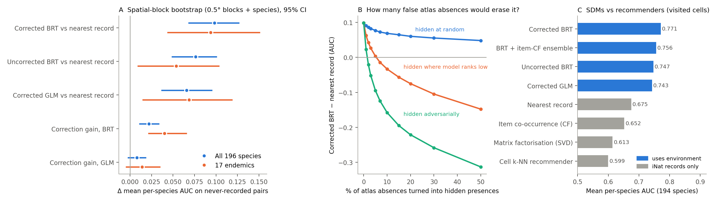

# Phase D: is the atlas headline robust, and is an SDM needed at all?

EVST Topic 11 · 17 November 2026 · follows `reports/phase_b_validation.md` and `reports/phase_c_novelty_experiments.md`

The project's central claim (E09b) is this: scored against the Kerala Bird Atlas, a bias-corrected SDM ranks
the (cell, species) pairs that iNaturalist never recorded well above simple baselines. On those pairs it
scores AUC 0.758, against 0.659 for nearest record and 0.736 for the uncorrected BRT. Phase C listed what a
reviewer would still ask before believing it. This round closes three of those items:

1. **Spatial-block CIs on the per-species contrasts.** The Wilcoxon tests treat cells as independent.
2. **Sensitivity to atlas non-detections.** An atlas "absence" can be a species the atlas missed.
3. **A co-occurrence / matrix-completion baseline.** Could an environment-free recommender that completes the
   iNaturalist cell × species matrix do as well? If so, the SDM would not be what finds the missing species.

Both experiments run from committed results only (`E09b_kba_unrecorded_pairs.csv.gz`, `E09_kba_cells.csv`), so
anyone can reproduce them without the raw data. Reading those files reproduces every E09b number exactly
(mean AUCs and the 48.4% top-10% hit rate).



## 1. Spatial-block bootstrap (E16)

Atlas cells were grouped into 0.3° blocks (59 blocks, about 33 km) and 0.5° blocks (26 blocks, about 55 km).
Each of 2,000 replicates resamples blocks **and** species, recomputes each species' AUC with cell weights,
and averages the contrast. The interval therefore covers both spatial autocorrelation and the choice of
species.

| Contrast (mean per-species ΔAUC) | Point | 95% CI, 0.3° blocks | 95% CI, 0.5° blocks | Species better |
|---|---|---|---|---|
| Corrected BRT − nearest record | **+0.098** | [0.077, 0.120] | [0.068, 0.127] | 89% [77, 94] |
| Corrected BRT − uncorrected BRT | **+0.022** | [0.013, 0.032] | [0.011, 0.034] | 76% [64, 82] |
| Corrected GLM − nearest record | +0.066 | [0.043, 0.088] | [0.036, 0.096] | 84% |
| Uncorrected BRT − nearest record | +0.076 | [0.055, 0.099] | [0.048, 0.101] | 82% |
| Corrected GLM − uncorrected GLM | +0.008 | [−0.001, 0.018] | **[−0.003, 0.019]** | 61% |
| *Endemics (17):* corrected − uncorrected BRT | **+0.040** | [0.021, 0.066] | [0.021, 0.066] | 100% [76, 100] |
| *Endemics (17):* corrected BRT − nearest record | +0.094 | [0.047, 0.144] | [0.043, 0.151] | 100% |

- **The headline survives spatial resampling.** No interval for the corrected BRT comes close to zero. The
  "species better" intervals are from the 0.5° run.
- **One correction to our wording.** The bias-correction gain is solid for BRT but **not significant for GLM**
  once blocks are resampled (bootstrap p = 0.04 with 0.3° blocks, 0.08 with 0.5° blocks). The Wilcoxon
  p = 0.0007 overstated it. The claim should read "target-group background helps the flexible model". That
  also fits H2: flexible models absorb more bias, so they have more to gain from removing it.

## 2. Atlas non-detections (E16)

**2a. Full-effort cells only.** 607 of 844 atlas cells completed all 32 lists. Restricting truth to them
changes nothing: corrected BRT − nearest record is +0.092 (89% of species), and corrected − uncorrected BRT is
+0.024 (76%). In the 237 lower-effort cells, where atlas absences are more often false, the advantage is
**larger**, not smaller (+0.113 and +0.026). If missed presences were concentrated against the model, it would
shrink there.

**2b. Tipping point.** We turned a fraction of each species' atlas absences into presences and asked when the
corrected model's advantage over nearest record disappears.

| Hidden presences placed | 2% | 5% | 10% | 30% | 50% | Advantage gone at |
|---|---|---|---|---|---|---|
| At random | +0.086 | +0.077 | +0.069 | +0.055 | +0.048 | never (≤ 50%) |
| In the pairs the corrected model ranks lowest | +0.042 | +0.003 | −0.033 | −0.105 | −0.148 | ≈ 5% of absences |
| Adversarially (low for the model, high for the baseline) | −0.021 | −0.095 | −0.158 | −0.258 | −0.313 | ≈ 1.5% of absences |

Against the uncorrected BRT, the correction gain vanishes at about 7.5% (model-low placement) or below 1%
(adversarial placement).

**Reading.** If the atlas misses species independently of our model's scores, the result holds even when half
of all atlas absences are false. It can only be overturned if atlas misses fall specifically where the
corrected model ranks species low. Any AUC comparison can be overturned that way. Two facts argue against it:
- The atlas's 32 timed lists per cell are effort-standardised, so its misses track species detectability, not
  our covariates.
- In lower-effort atlas cells, the advantage grows (2a).

A per-species detectability check needs the list-level atlas file (`kba_data.csv`). Its loader already lives
in `src/evst/data/kba.py`, so that check is a short follow-up.

## 3. Environment-free recommenders (E17)

We rebuilt the iNaturalist recorded matrix (844 cells × 207 species, iNat ≤ 2020) from the pairs file. It holds
**4,396 recorded pairs, which fills 2.5% of the matrix**. 384 cells have at least one modelled species. Three
standard recommender baselines use **only** that matrix, with no environment and no atlas information:

- item co-occurrence (Jaccard collaborative filtering);
- cell k-nearest-neighbours by recorded composition (k = 25);
- a rank-8 SVD reconstruction.

We also built a pre-specified ensemble: the mean within-species rank of corrected BRT and item-CF, with no
fitted weights. Co-occurrence needs something recorded in the cell, so the comparison is on iNat-visited
cells.

| Method (visited cells, 194 species) | Mean AUC | vs corrected BRT | Species better than BRT | Top-10% hit rate |
|---|---|---|---|---|
| **Corrected BRT (TGB)** | **0.771** | – | – | **49.2%** |
| BRT + item-CF ensemble | 0.756 | −0.015 | 37% | 46.9% |
| Uncorrected BRT | 0.747 | −0.024 | 25% | 47.6% |
| Corrected GLM | 0.743 | −0.029 | 26% | 47.1% |
| Nearest record | 0.675 | −0.096 | 9% | 41.7% |
| Item co-occurrence (CF) | 0.652 | −0.119 | 7% | 37.7% |
| Matrix factorisation (SVD, r = 8) | 0.613 | −0.158 | 7% | 35.9% |
| Cell k-NN recommender (k = 25) | 0.599 | −0.172 | 4% | 38.6% |

Base rate: 27.1%. All differences from corrected BRT: Wilcoxon p < 10⁻⁴. The sensitivity grid (k = 10/50,
r = 4/16) never exceeds 0.63.

- **Recommenders lose badly, and even lose to nearest record.** A matrix this sparse carries too little signal.
  Most visited cells have 1–5 visits and a handful of common species. What finds the missing species is the
  environmental model, not pattern completion of the records.
- **Co-occurrence becomes useful only where iNaturalist is already dense.** In cells with more than 5 visits,
  item-CF reaches 0.714, and the ensemble edges corrected BRT (0.790 vs 0.785, +0.005, p = 0.14, n.s.). In
  cells with 1–5 visits it hurts (−0.024).
- Unvisited atlas cells are 52% of the landscape. There the recommenders have no input at all, and only the SDM
  can say anything.

**Limitation.** These recommenders learn co-occurrence from the atlas cells only. A stronger version would
learn species similarity from all Western Ghats iNaturalist bird cells. That needs the raw records, but the
conclusion is unlikely to flip, because the binding constraint is the per-cell sparsity of the cells being
scored.

## What this changes in our claims

| Claim | Status after phase D |
|---|---|
| Bias-corrected SDMs find species iNaturalist never recorded (vs nearest record) | **Strengthened**: +0.098, block-bootstrap CI [0.068, 0.127] |
| Bias correction (TGB) is what makes the difference | **Holds for BRT** (+0.022 [0.011, 0.034]) and **endemics** (+0.040 [0.021, 0.066]); **not significant for GLM**, so reword |
| Result is not an artefact of atlas non-detection | **Holds** unless atlas misses are concentrated against the model (about 5% of absences or more); the effort split argues against that |
| It takes an environmental model, not just a smarter use of the records | **New, supported**: recommender baselines score 0.60–0.65 vs 0.77; co-occurrence adds nothing until cells have > 5 visits |

This also answers the "co-occurrence or matrix-completion baseline" and "spatial-block CIs" items in phase C's
pre-submission list, and part of the "atlas non-detection" item.

## Reproduce
```bash
PYTHONPATH=src python experiments/E16_headline_robustness.py --boot 2000   # ~1.5 min on a laptop
PYTHONPATH=src python experiments/E17_cooccurrence_baselines.py            # ~10 s
PYTHONPATH=src python experiments/E16_E17_figure.py
```
Outputs: `results/E16_block_bootstrap.csv`, `results/E16_effort_subsets.csv`,
`results/E16_nondetection_tipping.csv`, `results/E17_species_auc.csv`, `results/E17_summary.csv`,
`results/E17_top10_hit_visited.csv`, `reports/figures/E16_E17_robustness.png`.
