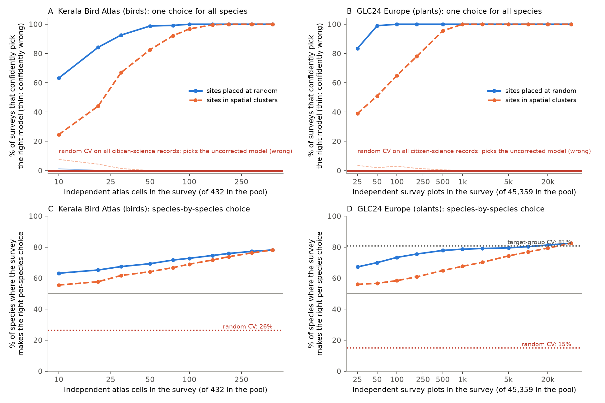

# Phase D: how much independent survey does it take to choose the right model? (E23)

EVST Topic 11 · 18 November 2026 · follows `reports/phase_d_glc_cnn.md`

H3 shows that random cross-validation on citizen-science records picks the uncorrected model for almost every species,
however many records it has. The deck's practical advice ends at "get independent surveys". This experiment asks how
many survey sites that takes.

**Answer.** About 50 survey sites settle the choice in both systems: 50 atlas cells in Kerala (6% of the atlas) and
50 survey plots in Europe (0.06% of them). That holds when the sites are spread at random. With sites in spatial clusters, as in a real
field campaign, it takes about 100 Kerala cells or 500 European plots. Random CV, using every citizen-science record,
gets the same choice wrong.



## Design

Per system and replicate:

1. **Two independent halves.** Survey sites are split into two halves by spatial block (Kerala: 0.3° blocks, 59 in
   all; Europe: 50 km blocks, 658 in all). Half A is the reference truth. Half B is the pool a survey is drawn from.
   Because the sample never touches the reference, agreement is with independent truth, not with itself.
2. **A survey of n sites** is drawn from B, either at random or clustered: whole blocks in random order until n sites
   are reached, the last block trimmed.
3. **Decisions.** On the sample, each species' survey AUC is computed for both models and differenced.
   - *One choice for all species:* the sign of the mean difference, and whether a one-sample Wilcoxon test on the
     per-species differences is significant (p < 0.05) in the right or the wrong direction.
   - *Species-by-species:* the share of species whose sign matches the reference. It counts species with ≥ 2
     presences and ≥ 2 absences in the sample and ≥ 5 presences in the reference.
4. **Survey-free checks** are scored against the same reference halves: random CV (held-out records vs random land)
   and, in Europe, target-group CV (held-out records vs other species' record sites).

Repetitions: 500 for Kerala, 200 for Europe.

**Models.**

- *Kerala:* the E09b BRT and GLM, each uncorrected vs target-group background, plus nearest record, on the 170,312
  never-recorded pairs (the H5 protocol). Read from the committed `results/E09b_kba_unrecorded_pairs.csv.gz`; the
  masked AUC code reproduces E09b's 0.758 exactly.
- *Europe:* the E19 seed-0 MLP and CNN, uncorrected vs target-group background, retrained with per-plot predictions
  saved. Survey AUCs match E19: MLP 0.810 / 0.766, CNN 0.813 / 0.769.

## 1. One choice for all species

Share of surveys that confidently pick the bias-corrected model (Wilcoxon p < 0.05, right sign):

| Sites in the survey | Kerala, BRT (random / clustered) | Europe, MLP (random / clustered) | Europe, CNN (random / clustered) |
|---|---|---|---|
| 10 | 63% / 25% | – | – |
| 25 | – | 84% / 39% | 91% / 31% |
| 30 | 93% / 67% | – | – |
| 50 | **99%** / 83% | **99%** / 51% | **99.5%** / 48% |
| 100 | 100% / **97%** | 100% / 65% | 100% / 70% |
| 200 | 100% / 100% | 100% / 78% | 100% / 78% |
| 500 | – | 100% / **95.5%** | 100% / 93% |
| 1,000 | – | 100% / 100% | 100% / 97% |

- **Confident wrong calls are rare and vanish quickly.**
  - Kerala BRT: at most 7.6% (10 clustered cells), and 0% from 50 cells.
  - Europe: at most 6.5% (25 clustered plots), and 0% from 1,000 plots.
- **Random CV is always wrong here.** With every iNaturalist or GLC record, it prefers the uncorrected model on average. It does so for 99% of
  Kerala species and 98.5–99% of European species.
- **Corrected BRT vs nearest record (Kerala, H5).** 20 random cells confidently pick the BRT 99% of the time; 50
  clustered cells, 96%.
- **The GLM correction is too small to settle** (+0.009). Even the full 432-cell half picks it confidently only 77%
  of the time, and clustered samples are confidently wrong up to 11% of the time. This matches E16: the GLM gain is
  not significant under the spatial-block bootstrap.

## 2. Species-by-species choice

Share of species where the survey's choice matches the reference half:

| Check | Kerala (BRT) | Europe (MLP) | Europe (CNN) |
|---|---|---|---|
| Random CV, all citizen-science records | **26%** | **15%** | **16%** |
| Target-group CV, all records | – | 81% | 80% |
| Survey, smallest sample (10 Kerala cells / 25 European plots, random) | 63% | 67% | 70% |
| Survey, 100 sites, random | 73% | 73% | 73% |
| Survey, full half (432 cells / 45,359 plots) | 78% | 82.5% | 82% |

- **Even the smallest survey beats random CV** (63–70% vs 15–26%). Random CV is worse than a coin flip because it
  systematically rewards the bias.
- **The full half is the ceiling**: two independent halves of the same survey agree on 78–82.5% of species. No check
  can do better than that.
- **Target-group CV comes close to the ceiling in Europe** (81% vs 82.5%), with no survey data at all. This
  strengthens slide 9's "one internal check works".
- Small samples score only the species they can decide. With 25 European plots that is about 70 common species, so
  read the small-n species numbers together with the counts in `results/E23/E23_*_summary.csv`.

## What this adds to the claims

| Claim | Before | After E23 |
|---|---|---|
| Practical advice: validate against independent surveys | Qualitative | **About 50 well-spread survey sites settle the model choice in both systems; clustered campaigns need 100 (Kerala) to 500 (Europe)** |
| H3: random CV picks the wrong model | 4 systems | Quantified: a 10-cell survey beats random CV on every record, and random CV agrees with independent truth less often than a coin |
| Target-group CV as the survey-free fallback | Agrees with truth 62–86% | In Europe, as good per species as half the survey (81% vs 82.5%) |
| H4 wording | "Target-group background is best" | Confirmed for flexible models. The GLM gain is too small for any affordable survey to confirm |

## Caveats

- **The reference is half the same survey, not perfect truth.** It carries the survey's own detection errors. The
  occupancy analysis on the `phase-d` branch addresses that for Kerala.
- **"Random" placement is idealised.** The clustered design is the realistic one, which is why both are reported.
- **One seed.** Europe uses seed 0 only, where E19's three seeds differ by ≤ 0.003 AUC.
- **CV agreement differs from E19.** Kerala and Europe random-CV agreement here (26%, 15%) differs from the E09b and E19
  numbers (25.5%, 12%) because the reference is half the survey and species need ≥ 5 reference presences.

## Reproduce

```bash
PYTHONPATH=src python experiments/E23_survey_budget.py --system kerala        # ~7 min on a laptop, committed data only
sbatch scripts/ada_e23.sh     # on Ada: retrain the 4 seed-0 E19 models with saved predictions, then the Europe analysis
sbatch scripts/ada_e23b.sh    # analysis only, if the predictions already exist (~11 min on a GTX 1080 Ti)
PYTHONPATH=src python experiments/E23_figure.py
```
Outputs: `results/E23/E23_{kerala,glc}_summary.csv`, `*_cv_summary.csv`, per-replicate files, and
`reports/figures/E23_survey_budget.png`.
